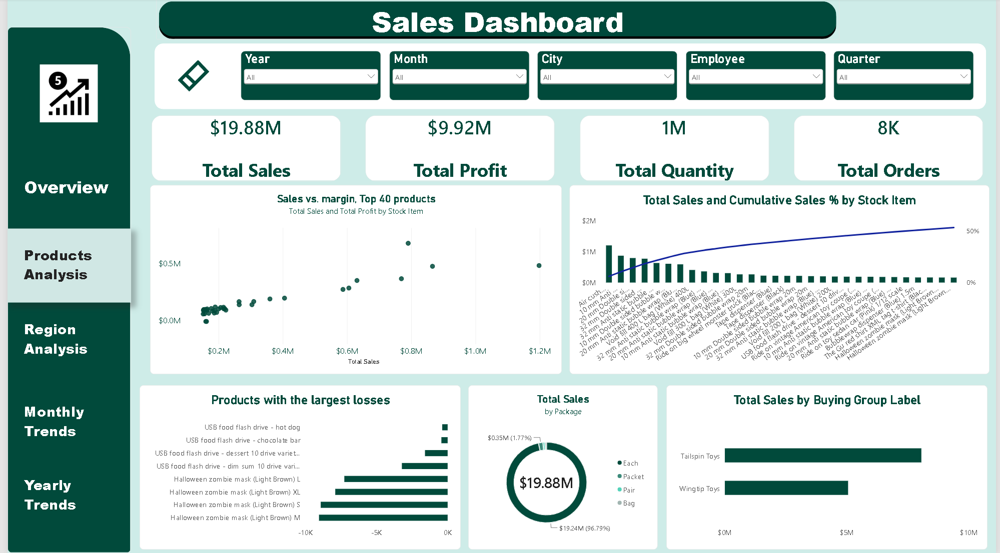

# Wwi-imports-sales-dashboard
# Wide World Importers – Product Performance Analysis

**An end-to-end data analysis project exploring product sales, profitability, and business performance using Excel, Power Query, SQL, and Power BI.**

---

## Project Overview

This project analyzes sales data from the Microsoft Wide World Importers sample database to evaluate product performance and identify opportunities for improving business profitability.

The analysis focuses on understanding which products generate the most revenue, which contribute most to profitability, and which products may require pricing or performance reviews.

The project follows a complete analytical workflow, from data preparation and exploratory analysis to interactive dashboard development and business recommendations.

## Business Questions

- Which products generate the highest sales revenue?
- Are high-revenue products also highly profitable?
- Which products generate losses?
- How concentrated is revenue among the top-performing products?
- How do sales vary across product categories, package types, and customer groups?

## Tools & Technologies

| Tool | Application |
|---|---|
| Microsoft Excel | Data exploration and initial analysis |
| Power Query | Data cleaning and transformation |
| SQL | Data querying and manipulation |
| Power BI | Interactive dashboard development |
| DAX | Calculated measures and KPIs |

## Project Workflow

### 1. Data Preparation & Cleaning
- Inspected the source data and explored its structure.
- Identified missing and unknown customer records.
- Cleaned and transformed relevant columns using Power Query.
- Prepared the data for analysis and visualization.
- Established relationships between fact and dimension tables.

### 2. Exploratory Data Analysis
- Analyzed sales and profit distributions.
- Identified top-performing and loss-making products.
- Investigated product-level profitability.
- Examined customer and package-type sales distributions.

### 3. Dashboard Development

Developed an interactive Power BI dashboard consisting of two analytical pages:

**Page 1 – Sales Overview**
- Total Sales
- Total Profit
- Profit Margin
- Sales Trends
- Sales by State
- Key Business KPIs

**Page 2 – Product Analysis**
- Sales vs. Profit Margin by Product
- Product Revenue Contribution (Pareto Analysis)
- Loss-Making Products
- Sales by Package Type
- Sales by Customer Buying Group

## Key Findings

The analysis revealed several important business insights:

1. **Revenue Concentration:** The top 10 products contribute approximately 33% of total sales, while 68 out of 227 products account for approximately 80% of revenue.

2. **Loss-Making Products:** Halloween Zombie Masks were identified as loss-making products, with the four sizes generating approximately $33K in combined losses.

3. **Customer Data Quality:** Approximately 34% of total sales ($6.77M) are associated with unknown customer records, limiting the reliability of customer-level analysis.

4. **Product Profitability:** High sales volume does not necessarily translate into high profitability, highlighting the importance of analyzing profit margins alongside revenue.

## Business Recommendations

Based on the findings:

- Review pricing, costs, and profitability for products generating losses.
- Prioritize inventory and performance monitoring for high-revenue products.
- Investigate missing customer information to improve customer segmentation and reporting.
- Evaluate products based on both revenue contribution and profit margin rather than sales volume alone.

## Dashboard Preview

### Sales Overview

### Product Analysis

## Limitations

- A portion of sales transactions is associated with unknown customer records.
- The dataset covers a historical period (2013–2016), so the findings should not be interpreted as current market performance.
- The analysis is based on the available sample dataset and its underlying assumptions.

## What I Learned

Through this project, I strengthened my understanding of:

- Data cleaning and transformation.
- Exploratory data analysis.
- Data modeling and relationships.
- DAX measures and calculated KPIs.
- Interactive dashboard development.
- Translating analytical findings into business recommendations.

---

**Project Type:** Data Analytics | Business Intelligence | Product Analysis

**Author:** Kareem Walid Hafez

**Tools:** Excel | SQL | Power Query | Power BI | DAX
